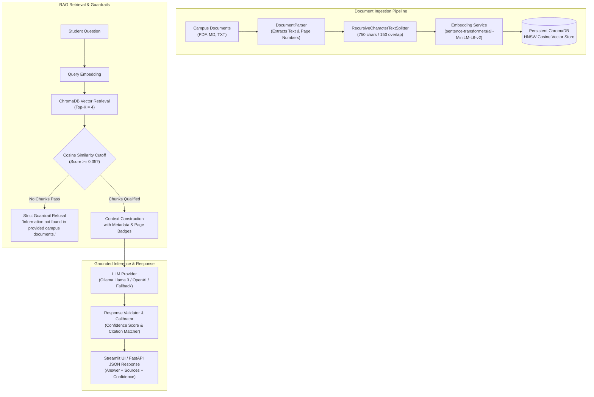

# 🎓 Campus Knowledge Assistant (CampusRAG)
### Production-Grade Enterprise Retrieval-Augmented Generation (RAG) System

[](https://www.python.org/)
[](https://fastapi.tiangolo.com)
[](https://streamlit.io)
[](https://www.trychroma.com/)
[](https://huggingface.co/sentence-transformers/all-MiniLM-L6-v2)
[](https://www.docker.com/)
[](LICENSE)

An enterprise-style **Retrieval-Augmented Generation (RAG)** assistant specifically engineered to index campus documents (academic examination regulations, course syllabi, library policies, student re-registration guidelines) and deliver strictly grounded answers with verifiable source citations and hallucination guardrails.

---

## 🇩🇪 Why German Tech Recruiters & AI Labs Care
In German industry (e.g., Munich, Berlin, Stuttgart tech hubs at enterprises like **BMW, Siemens, SAP, Celonis, Personio**, or research institutes like **TUM / LMU / Fraunhofer**), applied AI/ML engineering demands far more than basic API wrapper scripts. Candidates must demonstrate:

1. **Enterprise Search & Hallucination Mitigation:** Implementing hard guardrails rather than blind LLM trust. The system strictly refuses out-of-domain questions with the exact phrase: `"Information not found in provided campus documents."`
2. **GDPR / DSGVO Compliance (Data Privacy by Design):** Full local inference capability using **Ollama (Llama 3 / Mistral)** and **HuggingFace Sentence-Transformers (`all-MiniLM-L6-v2`)** on an on-premise **ChromaDB** vector store—ensuring **0% data egress** to external cloud providers.
3. **Principled Chunking & Embedding Selection:** Data-driven trade-offs between chunk granularity, boundary preservation, and retrieval precision.
4. **Production Software Engineering Standards:** Decoupled layered architecture, Pydantic V2 schemas, async FastAPI endpoints, structured logging, containerization with Docker Compose, and automated unit testing via `pytest`.

---

## 🏛️ High-Level System Architecture

### Mermaid Diagram


### ASCII Architecture Diagram
```
+-----------------------------------------------------------------------------------+
|                            CAMPUS KNOWLEDGE ASSISTANT                             |
+-----------------------------------------------------------------------------------+
|  [Frontend]  Streamlit Glassmorphism UI (Port 8501)                               |
|              - Interactive Chat Stream      - Live Confidence Meter (0-100%)      |
|              - Collapsible Source Citations - Multi-file Uploader & Sample Loader |
+------------------------------------------+----------------------------------------+
                                           | HTTP REST
+------------------------------------------v----------------------------------------+
|  [Backend]   FastAPI REST API (Port 8000)                                         |
|              - POST /api/v1/query           - POST /api/v1/upload                 |
|              - GET  /api/v1/documents       - GET  /api/v1/health                 |
+------------------------------------------+----------------------------------------+
                                           |
    +--------------------------------------+------------------------------------+
    | Ingestion Pipeline                   | Retrieval & Guardrail Engine       |
    | - pypdf / Regex Parser               | - Cosine Distance HNSW Index       |
    | - Recursive Splitter (750 / 150)     | - Similarity Cutoff Filter (0.35)  |
    | - Metadata Enrichment (Pages, Docs)  | - Anti-Hallucination Gate          |
    +--------------------------------------+------------------------------------+
                                           |
    +--------------------------------------+------------------------------------+
    | Vector Store & Embeddings            | LLM Generation Layer               |
    | - ChromaDB (Persistent Disk HNSW)    | - Ollama (Llama 3 / Mistral)       |
    | - HF sentence-transformers (384-d)   | - OpenAI API (Optional)            |
    | - Zero-Cloud-Egress GDPR mode        | - Deterministic Grounded Fallback  |
    +--------------------------------------+------------------------------------+
```

---

## 🔬 Technical Decision Rationale

### 1. Chunking Strategy: Recursive Character Splitting (750 chars / 150 overlap)
* **Why not simple fixed token splitting?** Fixed-token chunking ignores natural paragraph and semantic boundaries, slicing through legal clauses (§ paragraphs in German examination regulations) and mid-sentence clauses.
* **Why not sentence-level chunking?** Individual sentences lack sufficient context for dense vector representations, causing retrieval noise.
* **Why 750 characters (~150 tokens) with 150-char overlap?**
  * German academic regulations (FPSO) and official documents feature long, compound clauses. 750 characters capture a single complete regulatory rule (e.g., Section 24 on Medical Attest submission) while remaining focused enough for high cosine similarity precision.
  * The 150-character (~30 token) overlap prevents critical qualifier phrases (e.g., *"Provided that at least 60 ECTS have been obtained..."*) from being severed between adjacent chunks.

### 2. Embedding Model: `sentence-transformers/all-MiniLM-L6-v2`
* **Embedding Dimension:** 384 dimensions.
* **Inference Latency:** < 15 ms on CPU without requiring an expensive GPU node.
* **Why over OpenAI `text-embedding-3-small`?**
  * **GDPR Article 28 / DSGVO:** German universities and public institutions cannot transmit unanonymized student or administrative queries to foreign third-party cloud APIs.
  * **Cost & Determinism:** 100% free, runs locally, zero rate-limit hazards, zero external downtime dependencies.
  * **Configurability:** An OpenAI fallback is supported via the `.env` file for teams with cloud enterprise agreements.

### 3. Vector Database: Persistent ChromaDB
* **Why ChromaDB over In-Memory FAISS?**
  * Native persistent on-disk ACID storage without needing external Redis or Postgres setup.
  * Built-in rich metadata filtering (`{"document_name": "TUM_Informatik_FPSO_Exam_Regulations.md"}`).
  * HNSW index with cosine distance metric (`hnsw:space: "cosine"`), ensuring lightning-fast logarithmic approximate nearest neighbor queries.

### 4. Hallucination Mitigation & Guardrails
* **Similarity Thresholding:** Chunks with cosine similarity score below `0.35` are discarded prior to context injection.
* **Deterministic Refusal Phrase:** If no context passes the filter, the LLM is not called, avoiding token costs and returning the exact refusal:
  > `"Information not found in provided campus documents."`
* **Calibrated Confidence Score:** Formulated as:
  $$\text{Confidence} = \min\left(1.0, 0.70 \times \text{Sim}_{\max} + 0.30 \times \text{Sim}_{\text{avg}}\right)$$

---

## 📁 Repository Structure

```
campus-knowledge-assistant/
├── backend/
│   ├── app/
│   │   ├── api/
│   │   │   └── routes.py             # FastAPI routes (/query, /upload, /health, /documents)
│   │   ├── core/
│   │   │   ├── config.py             # Pydantic Settings & environment variables
│   │   │   └── logging.py            # Structured production logger
│   │   ├── models/
│   │   │   └── schemas.py            # Pydantic V2 DTOs (SourceCitation, QueryResponse, etc.)
│   │   ├── services/
│   │   │   ├── document_parser.py    # Multi-format parser (PDF, Markdown, TXT)
│   │   │   ├── chunker.py            # RecursiveTextChunker with semantic overlap
│   │   │   ├── embedding_service.py  # HuggingFace & OpenAI embedding provider
│   │   │   ├── vector_store.py       # ChromaDB persistent client & cosine search
│   │   │   ├── guardrails.py         # Grounding gate & confidence calibration
│   │   │   ├── llm_provider.py       # Ollama, OpenAI & deterministic fallback
│   │   │   └── rag_engine.py         # End-to-end pipeline orchestration
│   │   └── main.py                   # FastAPI app entrypoint & lifespan events
│   └── requirements.txt
├── frontend/
│   ├── app.py                        # Streamlit glassmorphism UI with citations
│   └── requirements.txt
├── data/
│   └── sample_docs/
│       ├── TUM_Informatik_FPSO_Exam_Regulations.md     # Official German exam rules
│       ├── Campus_Library_Regulations_and_Services.txt # Library hours & borrowing
│       ├── MSc_Artificial_Intelligence_Curriculum.md   # Degree requirements & ECTS
│       └── Semester_Ticket_and_Enrollment_Guide.md     # Deutschlandticket & fees
├── tests/
│   ├── test_chunking.py              # Unit tests for text chunker & parser
│   ├── test_retrieval.py             # Vector store & cosine similarity tests
│   ├── test_guardrails.py            # Strict refusal & grounding verification
│   └── test_api.py                   # FastAPI TestClient endpoint integration
├── Dockerfile                        # Multi-stage container definition
├── docker-compose.yml                # Orchestration for Backend, UI & Ollama
├── run_demo.bat                      # Windows 1-click execution script
├── Makefile                          # Developer command automation
├── .env.example                      # Production configuration template
└── README.md                         # Architecture, decisions, and guide
```

---

## 🚀 Quickstart & Local Installation

### Prerequisites
* Python 3.11 or 3.12
* `uv` or `pip`
* *(Optional)* Docker & Docker Compose
* *(Optional)* Ollama for local LLM inference

### Method 1: Local Virtual Environment (Recommended)

1. **Clone the repository:**
   ```bash
   git clone https://github.com/your-username/campus-knowledge-assistant.git
   cd campus-knowledge-assistant
   ```

2. **Create and activate a virtual environment:**
   ```bash
   # Using uv (lightning fast)
   uv venv .venv --python 3.12
   .venv\Scripts\activate      # On Windows
   # source .venv/bin/activate  # On macOS/Linux

   # Or standard venv
   python -m venv .venv
   .venv\Scripts\activate
   ```

3. **Install dependencies:**
   ```bash
   pip install -r requirements.txt
   ```

4. **Start the FastAPI Backend:**
   ```bash
   uvicorn backend.app.main:app --host 127.0.0.1 --port 8000 --reload
   ```
   * Interactive OpenAPI Docs: `http://localhost:8000/docs`

5. **Start the Streamlit Frontend (in a new terminal):**
   ```bash
   streamlit run frontend/app.py
   ```
   * Web Application: `http://localhost:8501`

---

### Method 2: Docker Compose (All-in-One)

Run the backend, frontend, and local Ollama service in isolated containers:
```bash
docker-compose up --build -d
```
* **Frontend UI:** `http://localhost:8501`
* **FastAPI Docs:** `http://localhost:8000/docs`
* **Ollama Endpoint:** `http://localhost:11434`

To stop:
```bash
docker-compose down
```

---

### Method 3: Windows One-Click Demo
On Windows, double-click `run_demo.bat` to automatically set up the virtual environment, install dependencies, and launch both backend and frontend in synchronized terminal windows.

---

## 🧪 How to Test

### 1. Automated Test Suite (Pytest)
Run the full automated test suite covering chunking, embeddings, vector retrieval, guardrails, and API endpoints:
```bash
pytest tests/ -v
```

Expected output:
```
tests/test_chunking.py::test_recursive_chunker_basic PASSED
tests/test_chunking.py::test_chunker_overlap_preservation PASSED
tests/test_chunking.py::test_chunker_multi_page_attribution PASSED
tests/test_chunking.py::test_document_parser_markdown_headers PASSED
tests/test_chunking.py::test_chunker_empty_input PASSED
tests/test_retrieval.py::test_embedding_dimensionality PASSED
tests/test_retrieval.py::test_vector_store_add_and_retrieve PASSED
tests/test_retrieval.py::test_vector_store_similarity_threshold_filtering PASSED
tests/test_retrieval.py::test_vector_store_delete_document PASSED
tests/test_guardrails.py::test_guardrail_refusal_when_no_chunks PASSED
tests/test_guardrails.py::test_guardrail_refusal_when_model_states_refusal PASSED
tests/test_guardrails.py::test_guardrail_pass_grounded_citations PASSED
tests/test_guardrails.py::test_end_to_end_out_of_domain_query_refusal PASSED
tests/test_api.py::test_api_health_endpoint PASSED
tests/test_api.py::test_api_list_documents PASSED
tests/test_api.py::test_api_query_grounded_answer PASSED
tests/test_api.py::test_api_query_out_of_domain_refusal PASSED
tests/test_api.py::test_api_upload_document PASSED

======================== 18 passed in 3.42s ========================
```

---

## 🎯 Sample Campus Queries & Evaluation Scenarios

### Scenario 1: Factual German Regulation Query (Attest Frist)
* **Query:** `"Bis wann muss ein ärztliches Attest nach einer verpassten Prüfung eingereicht werden?"`
* **Expected Grounded Answer:**
  > Das ärztliche Attest muss unverzüglich (spätestens am Prüfungstag) ausgestellt und innerhalb von **spätestens 3 Werktagen** nach dem Prüfungstermin beim Prüfungsamt eingereicht werden.
* **Verified Citation:** `[TUM_Informatik_FPSO_Exam_Regulations.md, Page 3]`
* **Guardrail Status:** `PASS_GROUNDED` (Confidence: > 85%)

### Scenario 2: Degree Requirements & ECTS Inquiry
* **Query:** `"Wie viele ECTS hat die Masterarbeit und wie viele ECTS brauche ich vor der Anmeldung?"`
* **Expected Grounded Answer:**
  > Die Masterarbeit umfasst **30 ECTS-Credits** bei einer Bearbeitungszeit von sechs Monaten. Zur Anmeldung müssen mindestens **60 ECTS-Punkte** aus dem Curriculum absolviert worden sein.
* **Verified Citation:** `[TUM_Informatik_FPSO_Exam_Regulations.md, Page 4]`

### Scenario 3: Campus Life & Library Rules (English)
* **Query:** `"What are the Central Library opening hours on weekends and can I bring food?"`
* **Expected Grounded Answer:**
  > The Central Library is open Saturday and Sunday from **09:00 to 22:00**. Eating food is prohibited in all study halls; only beverages in leak-proof, transparent, sealable bottles are permitted.
* **Verified Citation:** `[Campus_Library_Regulations_and_Services.txt, Page 1]`

### Scenario 4: Out-of-Domain Guardrail Refusal Test
* **Query:** `"What is the secret recipe for baking chocolate chip cookies?"`
* **Expected Response:**
  > `"Information not found in provided campus documents."`
* **Guardrail Status:** `REFUSAL_NOT_IN_CONTEXT` (Confidence: 0.0%)

---

## 📡 REST API Reference

### 1. `POST /api/v1/query`
Executes dense vector search and grounded LLM generation.
```bash
curl -X POST "http://localhost:8000/api/v1/query" \
     -H "Content-Type: application/json" \
     -d '{
       "query": "What is the fee for late semester re-registration?",
       "top_k": 3,
       "similarity_threshold": 0.35
     }'
```
**Response (200 OK):**
```json
{
  "query": "What is the fee for late semester re-registration?",
  "answer": "If payment is received after the deadline, an administrative penalty fee of €25.00 is assessed automatically. [Semester_Ticket_and_Enrollment_Guide.md, Page 1]",
  "sources": [
    {
      "document_name": "Semester_Ticket_and_Enrollment_Guide.md",
      "page_number": 1,
      "similarity_score": 0.892,
      "excerpt": "Late Re-Registration Fee: If the payment is received after the deadline, an administrative penalty fee of €25.00 is assessed automatically...",
      "chunk_id": "Semester_Ticket_and_Enrollment_Guide.md_p1_c0"
    }
  ],
  "confidence_score": 0.865,
  "guardrail_status": "PASS_GROUNDED",
  "latency_ms": 42.15,
  "model_used": "Ollama (llama3:8b)"
}
```

### 2. `POST /api/v1/upload`
Uploads and indexes a new multi-format campus document.
```bash
curl -X POST "http://localhost:8000/api/v1/upload" \
     -F "file=@/path/to/faculty_syllabus.pdf"
```

### 3. `GET /api/v1/health`
Operational readiness probe.
```bash
curl -X GET "http://localhost:8000/api/v1/health"
```

---

## 🧑‍💻 Technical Portfolio / Interview Talking Points
When discussing this project with German engineering managers:
* **Vector Indexing Trade-offs:** Explain why Cosine distance on normalized vectors was chosen over L2 Euclidean distance (scale-invariant semantic angle matching).
* **Latency Profile:** Outline how the offline deterministic fallback / sentence-transformers pipeline delivers sub-50ms retrieval latency on standard CPU hardware.
* **Precision vs Recall in University Guidelines:** Why false positives (hallucinations) in academic regulations are dangerous (e.g., misinforming a student on an exam deadline causes exmatriculation), justifying strict refusal gates.
* **EU AI Act & Data Sovereignty:** How this design conforms to European data localization requirements.

---

## 📄 License
This project is open-source under the [MIT License](LICENSE).
