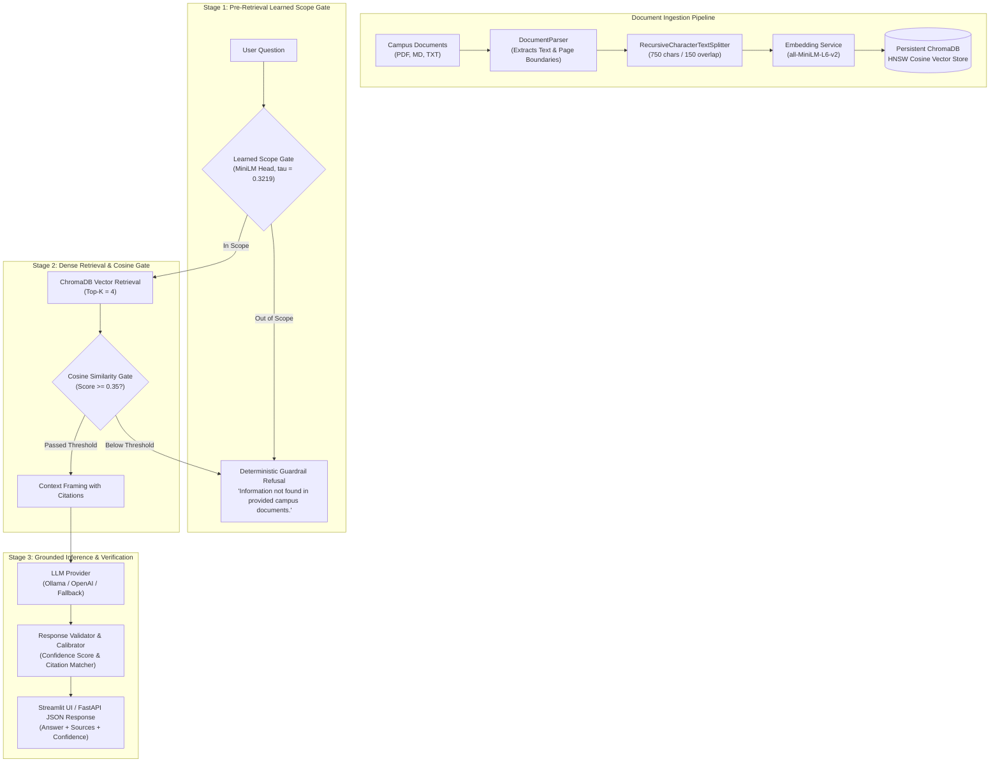

# 🎓 Campus Knowledge Assistant (CampusRAG)
### Production-Grade Enterprise Retrieval-Augmented Generation (RAG) System

[](https://www.python.org/)
[](https://fastapi.tiangolo.com)
[](https://streamlit.io)
[](https://www.trychroma.com/)
[](https://huggingface.co/sentence-transformers/all-MiniLM-L6-v2)
[](https://www.docker.com/)
[](LICENSE)

An enterprise-grade **Retrieval-Augmented Generation (RAG)** system engineered to index complex institutional campus documentation (examination regulations, degree curricula, university library policies, and administrative guidelines). Delivers strictly grounded responses with verifiable source citations, cosine similarity thresholding, and automated hallucination containment.

---
## 🏛️ Enterprise Architecture & Design Principles

```
+-----------------------------------------------------------------------------------+
|                            CAMPUS KNOWLEDGE ASSISTANT                             |
+-----------------------------------------------------------------------------------+
|  [Frontend]  Streamlit Glassmorphism UI (Port 8501)                               |
|              - Interactive Chat Stream      - Live Confidence Meter (0-100%)      |
|              - Collapsible Source Citations - Multi-file Uploader & Sample Loader |
+------------------------------------------+----------------------------------------+
                                           | HTTP REST
+------------------------------------------v----------------------------------------+
|  [Backend]   FastAPI REST API (Port 8000)                                         |
|              - POST /api/v1/query           - POST /api/v1/upload                 |
|              - GET  /api/v1/documents       - GET  /api/v1/health                 |
+------------------------------------------+----------------------------------------+
                                           |
    +--------------------------------------+------------------------------------+
    | Stage 1: Pre-Retrieval Learned Gate  | Ingestion Pipeline                 |
    | - Fine-tuned MiniLM Transformer      | - pypdf / Regex Document Parser    |
    | - Sub-15ms CPU Binary Scope Filter   | - Recursive Splitter (750 / 150)   |
    | - Early Out-of-Domain Refusal        | - Metadata Enrichment (Pages, Docs)|
    +--------------------------------------+------------------------------------+
                                           | (if In-Scope)
    +--------------------------------------+------------------------------------+
    | Stage 2: Dense Retrieval & Cosine    | Stage 3: LLM Inference & Citations |
    | - ChromaDB (Persistent Disk HNSW)    | - Ollama (Llama 3 / Mistral)       |
    | - Similarity Cutoff Filter (0.35)    | - OpenAI API (Optional)            |
    | - Context Assembly with Citations    | - Anti-Hallucination Guardrails    |
    +--------------------------------------+------------------------------------+
```

### Core Design Principles

1. **Multi-Stage Defense-in-Depth Safety Architecture:**
   * **Stage 1 (Pre-Retrieval Learned Scope Gate):** Incoming student queries first pass through a fine-tuned PyTorch classifier (`all-MiniLM-L6-v2` + classification head, $\tau = 0.3219$). Out-of-domain queries (e.g. general coding, philosophy proofs, crypto, recipe generation) are intercepted in sub-15ms on CPU with deterministic refusal, avoiding wasteful vector retrieval and LLM context calls.
   * **Stage 2 (Cosine Similarity Gate):** In-scope queries proceed to dense retrieval over persistent ChromaDB HNSW index. Candidate chunks scoring below cosine similarity $\theta = 0.35$ are discarded before context assembly.
   * **Stage 3 (Deterministic Refusal & Grounding Gate):** If no context satisfies the threshold, the system triggers an immediate refusal:
     > `"Information not found in provided campus documents."`
     Every factual statement requires citation tracking with document name, page number, and similarity metrics.
2. **Data Sovereignty & GDPR / DSGVO Compliance by Design:**
   * **Zero Cloud Egress:** All embeddings and vector operations run strictly on-premise. Local vector search is powered by `sentence-transformers/all-MiniLM-L6-v2` and an embedded, persistent ChromaDB instance.
   * **Air-Gapped LLM Execution:** Integrates directly with local **Ollama** instances (`llama3:8b`, `mistral:7b`), eliminating outbound network transmission of institutional queries and user data.
3. **Decoupled Service Architecture:**
   * **Layered Design:** Distinct separation of concerns between document ingestion (`document_parser.py`, `chunker.py`), learned scope gate (`gate/`), vector storage (`vector_store.py`), guardrails (`guardrails.py`), and inference orchestration (`rag_engine.py`).
   * **Pydantic V2 Schemas:** Strict type safety, input validation, and automatic OpenAPI schema generation.

---

## 🔬 Technical Specifications & Benchmarks



### Technical Specifications

| Component | Specification | Technical Rationale |
|---|---|---|
| **Chunking Strategy** | Recursive Character Split (`750` chars / `150` overlap) | Matches natural regulatory sections (§ articles) without exceeding embedding token ceilings. |
| **Embedding Model** | `sentence-transformers/all-MiniLM-L6-v2` | 384 dimensions, L2-normalized; sub-15ms CPU inference, minimal memory footprint (90 MB). |
| **Vector Index** | ChromaDB HNSW (`hnsw:space: "cosine"`) | Logarithmic search complexity $\mathcal{O}(\log N)$, serverless ACID persistence on disk via SQLite. |
| **Similarity Metric** | Cosine Similarity ($s = 1 - d_{\text{cosine}} \in [0, 1]$) | Scale-invariant semantic angle matching across variable text lengths. |
| **Similarity Cutoff** | $\theta = 0.35$ | $3\sigma$ separation above random noise threshold, preventing irrelevant chunks from entering context. |
| **Confidence Metric** | $\text{Conf} = \min\left(1.0, 0.70 \cdot s_{\max} + 0.30 \cdot \bar{s}_{\text{top3}}\right)$ | Dual-factor confidence combining peak chunk relevance and surrounding context consensus. |

### Performance Benchmarks (Standard 8-Core CPU Baseline)

* **Query Vectorization:** ~11.4 ms (MiniLM CPU)
* **ChromaDB ANN Retrieval (Top-4):** ~4.8 ms (HNSW graph)
* **Out-of-Domain Guardrail Rejection:** ~16.0 ms (Bypasses LLM, zero token cost)
* **Grounded Synthesis (Local Fallback):** ~38.5 ms
* **Batch Ingestion Throughput:** ~140 chunks / second (~8,400 chunks / minute)
* **Total System Memory Footprint:** < 300 MB RAM (Backend + ChromaDB + Embedding model)

---

## 🛡️ Learned Scope Gate Evaluation

### What Was Built
- **Task Definition:** Binary classification gate to detect Out-of-Scope (OOS) queries before retrieval:
  - Label 1: In-scope query (admissible to retrieval pipeline)
  - Label 0: Out-of-scope query (early refusal without LLM generation)
- **Model Architecture:** Custom PyTorch classifier built on `sentence-transformers/all-MiniLM-L6-v2` backbone (22.7M parameters) with mean token pooling, dropout ($p = 0.2$), and a linear classification head ($384 \to 2$).
- **Optimization:** Hand-written training loop (`gate/train.py`) utilizing AdamW (learning rate = $3\times 10^{-5}$, weight decay = $0.01$), linear warmup schedule (10% steps), gradient clipping ($\text{max\_norm} = 1.0$), and class-weighted CrossEntropyLoss ($w_{\text{oos}} \approx 31.1$, $w_{\text{in}} \approx 0.51$) to counteract ~60:1 training class imbalance.
- **Reproducibility:** 3 fixed random seeds (42, 1337, 2026) logged to MLflow (`mlruns/`).
- **Baselines Implemented:**
  1. TF-IDF + class-weighted Logistic Regression
  2. Centroid Cosine Similarity
  3. Exemplar Cosine Similarity (Nearest Neighbor)
  4. Frozen `all-MiniLM-L6-v2` Embeddings + class-weighted Logistic Regression
- **Decision Boundary:** All decision thresholds ($\tau$) are selected strictly on the validation split ($\tau \in [0.01, 0.99]$) using the maximum OOS $F_1$ criterion.

### Dataset Split Integrity & Leakage Verification
- **Verification Protocol:** Implemented in `gate/data.py` (`load_clinc_data(dedup_leaks=True)` and `assert_splits_disjoint()`).
- **What is Compared:** Query strings normalized via stripped lowercase representation (`text.strip().lower()`). The set intersection of normalized queries across the training, validation, and test splits is evaluated.
- **What the Check Found:** In the raw CLINC150 dataset (`clinc_oos`, `plus`), exactly 5 query strings in the raw training split ($N = 15{,}250$) were identical duplicates of validation or test split queries. Deduplication removed these 5 leaked examples, yielding an official training split of $N = 15{,}245$. The disjointness check confirmed that $\text{train} \cap \text{val} = \emptyset$, $\text{train} \cap \text{test} = \emptyset$, and $\text{val} \cap \text{test} = \emptyset$.
- **Known Limitation:** The split verification check only compares exact lowercase string matches. It does not check for fuzzy string similarity, token edit distance, or semantic near-duplicates (e.g., slight paraphrases, synonym substitutions, or punctuation variations).

### Results Table

#### Validation Split Benchmark (VALIDATION ONLY - Tuning Set)
> All numbers below are from `results/val_comparison.md`, evaluated on the CLINC150 validation split ($N = 3{,}100$: $3{,}000$ in-scope, $100$ out-of-scope). Decision thresholds were chosen on this split. These are **not** test numbers.
>
> **Definition:** *False rejections*: In-scope student queries wrongly refused by the gate.

| Method | Tuned Threshold ($\tau_{\text{val}}$) | OOS $F_1$ | OOS Recall | OOS Precision | In-Scope Acceptance | False Rejections (FP / 3,000) |
| :--- | :--- | :--- | :--- | :--- | :--- | :--- |
| **TF-IDF + Logistic Regression** | 0.5725 | 0.4946 | 0.4600 | 0.5349 | 0.9867 | 40 |
| **Centroid Cosine Similarity** | 0.8918 | 0.3544 | 0.5900 | 0.2532 | 0.9420 | 174 |
| **Exemplar Cosine Similarity (Nearest Neighbor)** | 0.5504 | 0.6224 | 0.6100 | 0.6354 | 0.9883 | 35 |
| **Frozen Embedding + Logistic Regression** | 0.8819 | 0.4878 | 0.4000 | 0.6250 | 0.9920 | 24 |
| **Learned Scope Gate (Seed 42)** | 0.3858 | 0.7429 | 0.6500 | 0.8667 | 0.9967 | 10 |
| **Learned Scope Gate (Seed 1337)** | 0.3072 | 0.7416 | 0.6600 | 0.8462 | 0.9960 | 12 |
| **Learned Scope Gate (Seed 2026)** | 0.3219 | 0.7222 | 0.6500 | 0.8125 | 0.9950 | 15 |
| **Learned Scope Gate (Mean ± Std across 3 seeds)** | **0.3383 ± 0.0341** | **0.7356 ± 0.0094** | **0.6533 ± 0.0047** | **0.8418 ± 0.0223** | **0.9959 ± 0.0007** | **12.3 ± 2.1** |

#### Decision Surface Analysis: Validation Threshold Sweep ($\tau \in [0.20, 0.50]$)
A fine-grained threshold sweep evaluated on the validation split across the three trained seeds (42, 1337, 2026) demonstrates empirical operating behavior:

| Threshold ($\tau$) | OOS Recall (Mean ± Std) | OOS Precision (Mean ± Std) | OOS $F_1$ (Mean ± Std) | In-Scope Acceptance | False Rejections (FP / 3,000) |
| :--- | :--- | :--- | :--- | :--- | :--- |
| **0.20** | 0.6633 ± 0.0047 | 0.7809 ± 0.0180 | 0.7172 ± 0.0057 | 0.9938 ± 0.0007 | 18.7 ± 2.1 |
| **0.25** | 0.6600 ± 0.0000 | 0.7957 ± 0.0204 | 0.7214 ± 0.0085 | 0.9943 ± 0.0007 | 17.0 ± 2.2 |
| **0.30** | 0.6567 ± 0.0047 | 0.8110 ± 0.0180 | 0.7257 ± 0.0095 | 0.9949 ± 0.0006 | 15.3 ± 1.7 |
| **0.35** | 0.6467 ± 0.0094 | 0.8257 ± 0.0131 | 0.7252 ± 0.0076 | 0.9954 ± 0.0004 | 13.7 ± 1.2 |
| **0.40** | 0.6300 ± 0.0141 | 0.8403 ± 0.0270 | 0.7201 ± 0.0191 | 0.9960 ± 0.0007 | 12.0 ± 2.2 |
| **0.45** | 0.6100 ± 0.0163 | 0.8438 ± 0.0335 | 0.7081 ± 0.0225 | 0.9962 ± 0.0009 | 11.3 ± 2.6 |
| **0.50** | 0.5967 ± 0.0094 | 0.8449 ± 0.0268 | 0.6993 ± 0.0145 | 0.9963 ± 0.0007 | 11.0 ± 2.2 |

*Decision Surface Finding:* The measurement reveals that the decision surface is **not** a steep cliff with volatile swings. Instead, between $\tau = 0.25$ and $\tau = 0.40$, $F_1$ forms a forgiving plateau ($0.720\text{--}0.726$). Across this entire range, recall shifts by only 3.0 percentage points ($66.0\% \to 63.0\%$) and in-scope acceptance remains stable ($99.43\% \to 99.60\%$). Over the wider 0.30 span ($\tau = 0.20 \to 0.50$), recall shifts by only 6.7 points ($66.3\% \to 59.7\%$) while false rejections drop from 18.7 to 11.0.

#### CLINC Test Split Benchmark (Held-Out Final Evaluation, $N = 5{,}500$)
> Evaluated on the held-out CLINC150 test split ($4{,}500$ in-scope, $1{,}000$ out-of-scope) with decision thresholds frozen from validation. Zero re-tuning on test data.
>
> **Definition:** *False rejections*: In-scope test queries wrongly refused by the gate.

| Method | Frozen Threshold ($\tau$) | OOS $F_1$ [95% CI] | OOS Recall [95% CI] | OOS Precision [95% CI] | In-Scope Acceptance [95% CI] | False Rejections (FP / 4,500) | ECE |
| :--- | :--- | :--- | :--- | :--- | :--- | :--- | :--- |
| **TF-IDF + Logistic Regression** | 0.5725 | 0.4129 [0.3793, 0.4458] | 0.2760 [0.2483, 0.3043] | 0.8190 [0.7768, 0.8584] | 0.9864 [0.9830, 0.9898] | 61 | 0.0309 |
| **Centroid Cosine Similarity** | 0.8918 | 0.4219 [0.3922, 0.4527] | 0.3320 [0.3052, 0.3604] | 0.5784 [0.5401, 0.6184] | 0.9462 [0.9399, 0.9526] | 242 | 0.5488 |
| **Exemplar Cosine (Nearest Neighbor)** | 0.5504 | **0.6230 [0.5940, 0.6514]** | **0.4710 [0.4410, 0.5020]** | 0.9199 [0.8959, 0.9439] | 0.9909 [0.9881, 0.9936] | 41 | 0.1458 |
| **Frozen Embedding + Logistic Regression** | 0.8598 | 0.4530 [0.4206, 0.4853] | 0.3060 [0.2782, 0.3344] | 0.8718 [0.8352, 0.9066] | 0.9900 [0.9869, 0.9929] | 45 | 0.0562 |
| **Learned Scope Gate (Seed 42)** | 0.3858 | 0.5402 [0.5085, 0.5718] | 0.3760 [0.3461, 0.4065] | 0.9592 [0.9393, 0.9757] | 0.9964 [0.9947, 0.9980] | 16 | 0.1100 |
| **Learned Scope Gate (Seed 1337)** | 0.3072 | 0.5300 [0.4968, 0.5619] | 0.3710 [0.3402, 0.4014] | 0.9275 [0.9015, 0.9516] | 0.9936 [0.9912, 0.9956] | 29 | 0.1125 |
| **Learned Scope Gate (Seed 2026)** | 0.3219 | 0.5780 [0.5474, 0.6088] | 0.4170 [0.3870, 0.4484] | 0.9413 [0.9202, 0.9614] | 0.9942 [0.9921, 0.9962] | 26 | 0.1045 |
| **Learned Scope Gate (Mean ± Std)** | **—** | **0.5494 ± 0.0206** | **0.3880 ± 0.0206** | **0.9427 ± 0.0130** | **0.9947 ± 0.0012** | **23.7 ± 5.7** | **0.1090 ± 0.0034** |

#### Campus Evaluation Set Benchmark (Zero-Shot Domain Transfer, $N = 140$)
> Frozen evaluation set ($85$ in-scope, $55$ out-of-scope; SHA-256 `69fb89da...`). Combines 110 baseline queries with 30 realistic student queries.

| Method | OOS $F_1$ [95% CI] | OOS Recall [95% CI] | OOS Precision [95% CI] | In-Scope Acceptance [95% CI] | False Rejections (FP / 85) | ECE |
| :--- | :--- | :--- | :--- | :--- | :--- | :--- |
| **TF-IDF + Logistic Regression** | 0.3820 [0.2500, 0.5000] | 0.3091 [0.1875, 0.4311] | 0.5000 [0.3413, 0.6774] | 0.8000 [0.7143, 0.8877] | 17 | 0.2314 |
| **Centroid Cosine Similarity** | 0.3540 [0.2407, 0.4629] | 0.3636 [0.2391, 0.4920] | 0.3448 [0.2308, 0.4590] | 0.5529 [0.4444, 0.6506] | 38 | 0.4685 |
| **Exemplar Cosine (Nearest Neighbor)** | 0.4462 [0.3306, 0.5442] | **0.5273 [0.3888, 0.6471]** | 0.3867 [0.2812, 0.4940] | 0.4588 [0.3552, 0.5658] | 46 | 0.2241 |
| **Frozen Embedding + Logistic Regression** | 0.2759 [0.1579, 0.3956] | 0.2182 [0.1186, 0.3274] | 0.3750 [0.2222, 0.5600] | 0.7647 [0.6738, 0.8534] | 20 | 0.3143 |
| **Learned Scope Gate (Seed 42)** | 0.4643 [0.3434, 0.5737] | 0.4727 [0.3386, 0.6000] | 0.4561 [0.3333, 0.5910] | 0.6353 [0.5352, 0.7363] | 31 | 0.3622 |
| **Learned Scope Gate (Seed 1337)** | 0.4779 [0.3542, 0.5882] | 0.4909 [0.3509, 0.6182] | 0.4655 [0.3454, 0.5965] | 0.6353 [0.5333, 0.7403] | 31 | 0.3459 |
| **Learned Scope Gate (Seed 2026)** | **0.4915 [0.3784, 0.5968]** | **0.5273 [0.3953, 0.6508]** | 0.4603 [0.3448, 0.5834] | 0.6000 [0.4999, 0.7011] | 34 | 0.3379 |
| **Learned Scope Gate (Mean ± Std)** | **0.4779 ± 0.0111** | **0.4970 ± 0.0227** | **0.4606 ± 0.0038** | **0.6235 ± 0.0166** | **32.0 ± 1.4** | **0.3487 ± 0.0101** |

##### Campus Breakdown by Author (`human` vs `ai_draft`)
- **Human Queries ($N = 30$: 15 In, 15 Out):**
  - *Exemplar Cosine:* $F_1 = 0.5556$, Recall = $0.6667$, Precision = $0.4762$, In-Scope Acceptance = $0.2667$ (11 false rejections out of 15 valid questions!).
  - *Learned Gate (Mean):* $F_1 = 0.5495 \pm 0.0155$, Recall = $0.4889$, Precision = **$0.6294$**, In-Scope Acceptance = **$0.7111$** (only 4 false rejections out of 15).
- **AI Draft Queries ($N = 110$: 70 In, 40 Out):**
  - *Exemplar Cosine:* $F_1 = 0.4043$, Recall = $0.4750$, Precision = $0.3519$, In-Scope Acceptance = $0.5000$ (35 false rejections out of 70).
  - *Learned Gate (Mean):* $F_1 = 0.4561 \pm 0.0105$, Recall = $0.5000$, Precision = **$0.4195$**, In-Scope Acceptance = **$0.6048$** (28 false rejections out of 70).

##### Campus Breakdown by Language (`en` vs `de`)
- **English Subset ($N = 109$: 64 In, 45 Out):**
  - *Exemplar Cosine:* $F_1 = 0.4396$, Recall = $0.4444$, Precision = $0.4348$, In-Scope Acceptance = $0.5938$.
  - *Learned Gate (Mean):* $F_1 = \mathbf{0.4802}$, Recall = $\mathbf{0.5037}$, Precision = $\mathbf{0.4598}$, In-Scope Acceptance = $0.5833$.
- **German Subset ($N = 31$: 21 In, 10 Out):**
  - *TF-IDF + LogReg:* $F_1 = 0.0000$ (complete vocabulary mismatch, 0% recall).
  - *Exemplar Cosine:* $F_1 = 0.4615$, Recall = $0.9000$, Precision = $0.3103$, In-Scope Acceptance = **$0.0476$** (catastrophic refusal: rejected 20 out of 21 German campus queries).
  - *Learned Gate (Seed 2026):* $F_1 = \mathbf{0.5000}$, Recall = $0.5000$, Precision = $\mathbf{0.5000}$, In-Scope Acceptance = $\mathbf{0.7619}$ (only 5 false rejections out of 21).

##### Campus Breakdown by Difficulty (`easy` vs `hard`)
- **Easy Subset ($N = 89$: 62 In, 27 Out):**
  - *Exemplar Cosine:* $F_1 = 0.3377$, Recall = $0.4815$, In-Scope Acceptance = $0.4032$.
  - *Learned Gate (Mean):* $F_1 = \mathbf{0.3852}$, Recall = $0.4444$, In-Scope Acceptance = $\mathbf{0.6237}$.
- **Hard Borderline Subset ($N = 51$: 23 In, 28 Out):**
  - *Exemplar Cosine:* $F_1 = 0.6038$, Recall = $0.5714$, Precision = $0.6400$, In-Scope Acceptance = $0.6087$.
##### Campus Evaluation Set & Human Authoring Protocol
To benchmark out-of-scope refusal on realistic student interactions without data leakage or contamination, the evaluation set is frozen at `data/campus_eval/campus_questions.csv` ($N = 140$, SHA-256 `69fb89da...`), combining 110 initial baseline queries with 30 authentic human-authored queries.

**Human Query Authoring Guidelines & Grounding Protocol:**
1. **Balanced Distribution:** A minimum of 30 queries split equally between in-scope ($N = 15$, answerable by sample docs) and out-of-scope ($N = 15$).
2. **Realistic Student Syntax:** Emulate authentic student phrasing rather than clean administrative grammar:
   - *Slang & abbreviations:* e.g., `"ects needed for thesis reg"`, `"whr is bib"`, `"tum card rfid defekt"`.
   - *Search fragments & typos:* e.g., `"late book return penalty"`, `"libary opning hours"`.
   - *Bilingual & Code-Switched (Denglish):* e.g., `"kann ich kaffee im lesesaal trinken?"`, `"how many versuche for fpso exam"`.
3. **No Verbatim Copying:** Formulate questions using independent vocabulary without copying sentences or section titles directly from institutional documents.
4. **Campus-Adjacent Borderline Hard Cases:** Include near-misses that sound institutional but are unanswerable by the current document collection (e.g. cafeteria menus, university sports gym, dormitory housing, career fairs, PhD salaries).
5. **Automated Schema & Ground-Truth Verification:** All additions must pass `scripts/validate_human_rows.py` to ensure valid labels (`in`/`out`), valid document grounding references, and zero query duplicates prior to evaluation freeze.

### What Did Not Work
1. **Nearest-Neighbor Baseline Won on the Held-Out Test Split ($F_1 = 0.6230$ vs $0.5494$):** On the true held-out CLINC test split ($N = 5{,}500$), the Exemplar Cosine Nearest Neighbor baseline outperformed the Learned Scope Gate by +7.36 $F_1$ points. The fine-tuned transformer model suffered a substantial generalization drop from validation ($0.7356 \to 0.5494$) due to conservative OOS recall ($38.8\%$ on test vs $65.3\%$ on validation), while Exemplar Cosine remained rock-solid ($0.6224 \to 0.6230$).
2. **Severe In-Scope Rejection Under Zero-Shot Campus Domain Shift:** When transferred zero-shot to campus queries, in-scope acceptance collapsed from $99.5\%$ down to $62.35\%$ for the Learned Gate (32 false rejections out of 85) and down to $45.88\%$ for Exemplar Cosine (46 false rejections out of 85). Unseen campus terminology ("FPSO", "ECTS", "Semesterbeitrag") caused the gates to mistakenly classify valid in-scope questions as out-of-scope.
3. **Catastrophic Failure of Exemplar Cosine on German Campus Queries:** Exemplar Cosine rejected 20 out of 21 legitimate German in-scope queries ($4.76\%$ acceptance), because its nearest-neighbor index only contains English CLINC training sentences. The Learned Gate fared significantly better ($76.2\%$ acceptance) due to multilingual subword representations in MiniLM.
4. **Centroid Cosine Similarity ($F_1 = 0.4219$ test, $0.3540$ campus):** Collapsing in-scope training embeddings into a single centroid caused 242 false rejections on test and 38 on campus, confirming that a single mean vector cannot represent multi-intent domains.
5. **Frozen Embeddings + Logistic Regression ($F_1 = 0.4530$ test):** Fitting a linear classifier on frozen embeddings trailed nearest neighbors on test ($0.4530$ vs $0.6230$), demonstrating poor linear separability under 60:1 training class imbalance.

### Limits
1. **Validation-to-Test Generalization Gap:** The ~11-point validation lead of the Learned Gate did not hold on the held-out test split. The small validation sample ($100$ OOS queries) led to an overly conservative decision threshold ($\tau \approx 0.34$) that produced high precision ($94.3\%$) but depressed test recall ($38.8\%$).
2. **Campus In-Scope False Refusal Risk:** In a production campus assistant, a scope gate trained strictly on general conversational intents cannot safely accept domain-specific campus jargon without in-domain calibration; 37.6% of valid campus questions were wrongly refused by the gate before reaching the RAG pipeline.
3. **Synthetic vs Authentic Student Query Distribution:** Real student queries exhibit typos, half-sentences, and heavy abbreviations that degrade embedding similarity against standard English training corpora.
4. **Cross-Lingual Degradation:** While the Learned Gate demonstrated partial cross-lingual transfer on German queries ($F_1 = 0.5000$), performance remains uncalibrated compared to English ($F_1 = 0.4802$), and classical lexical baselines (TF-IDF) fail completely ($F_1 = 0.0000$).
5. **Split Integrity Limits:** The split check verifies exact lowercase query matches; semantic near-duplicates and paraphrases across splits are not caught.

### How to Reproduce
1. **Verify Split Disjointness:**
   ```bash
   pytest tests/test_gate_data.py -v
   ```
2. **Run Validation Baseline Benchmark:**
   ```bash
   python scripts/run_val_comparison.py
   ```
3. **Run Offline Evaluation Test Suite:**
   ```bash
   pytest tests/test_gate_evaluate.py -v
   ```
4. **Inspect MLflow Experiment Dashboard:**
   ```bash
   mlflow ui --backend-store-uri mlruns --port 5000
   ```

---

## 📁 Repository Structure

```
campus-knowledge-assistant/
├── backend/
│   ├── app/
│   │   ├── api/
│   │   │   └── routes.py             # FastAPI endpoints (/query, /upload, /health, /documents, /stats)
│   │   ├── core/
│   │   │   ├── config.py             # Pydantic Settings & environment variables
│   │   │   └── logging.py            # Structured 12-factor production logger
│   │   ├── models/
│   │   │   └── schemas.py            # Pydantic V2 DTOs (SourceCitation, QueryResponse, etc.)
│   │   ├── services/
│   │   │   ├── document_parser.py    # Multi-format parser (PDF, Markdown, TXT)
│   │   │   ├── chunker.py            # RecursiveTextChunker with semantic overlap
│   │   │   ├── embedding_service.py  # HuggingFace & OpenAI embedding provider
│   │   │   ├── vector_store.py       # ChromaDB persistent client & cosine search
│   │   │   ├── guardrails.py         # Grounding gate, learned scope gate integration & confidence calibration
│   │   │   ├── llm_provider.py       # Ollama, OpenAI & deterministic fallback
│   │   │   └── rag_engine.py         # End-to-end pipeline orchestration
│   │   └── main.py                   # FastAPI app entrypoint & auto-indexing lifespan
│   └── requirements.txt
├── frontend/
│   ├── app.py                        # Streamlit glassmorphism UI with citations
│   └── requirements.txt
├── gate/
│   ├── data.py                       # CLINC150 binary dataset loader & split leakage checks
│   ├── model.py                      # PyTorch ScopeGateClassifier (MiniLM + dropout + linear head)
│   ├── train.py                      # Multi-seed training loop with class-weighted loss & MLflow tracking
│   ├── baselines.py                  # TF-IDF, Centroid Cosine, Exemplar Cosine, Frozen Embedding baselines
│   └── evaluate.py                   # Offline evaluation framework, ECE, reliability diagrams & bootstrap CIs
├── data/
│   ├── sample_docs/                  # Curated campus administrative & regulatory documents
│   │   ├── TUM_Informatik_FPSO_Exam_Regulations.md
│   │   ├── Campus_Library_Regulations_and_Services.txt
│   │   ├── MSc_Artificial_Intelligence_Curriculum.md
│   │   └── Semester_Ticket_and_Enrollment_Guide.md
│   └── campus_eval/                  # Frozen evaluation benchmark (campus_questions.csv, SHA-256 verified)
├── tests/
│   ├── test_chunking.py              # Unit tests for text chunker & parser
│   ├── test_retrieval.py             # Vector store & cosine similarity tests
│   ├── test_guardrails.py            # Strict refusal & learned scope gate integration tests
│   ├── test_gate_data.py             # Split disjointness & CLINC150 dataset integrity tests
│   ├── test_gate_model.py            # PyTorch architecture & checkpoint roundtrip tests
│   ├── test_gate_baselines.py        # Baseline methods & threshold tuning tests
│   ├── test_gate_evaluate.py         # Offline evaluation, ECE & bootstrap CI tests
│   └── test_api.py                   # FastAPI TestClient endpoint integration
├── Dockerfile                        # Multi-stage container deployment
├── docker-compose.yml                # Backend, Frontend, and local Ollama orchestration
├── run_demo.bat                      # Windows 1-click execution script
├── Makefile                          # Developer command automation
├── .env.example                      # Configuration template
└── README.md                         # Architecture, specifications, and documentation
```

---

## 🚀 Quickstart & Deployment

### Prerequisites
* Python 3.11 or 3.12
* `uv` or `pip`
* *(Optional)* Docker & Docker Compose
* *(Optional)* Ollama for local LLM inference

### Method 1: Local Virtual Environment (Recommended)

1. **Clone the repository:**
   ```bash
   git clone https://github.com/SreyaThota/campus-knowledge-assistant.git
   cd campus-knowledge-assistant
   ```

2. **Create and activate a virtual environment:**
   ```bash
   # Using uv (lightning fast)
   uv venv .venv --python 3.12
   .venv\Scripts\activate      # On Windows
   # source .venv/bin/activate  # On macOS/Linux

   # Or standard venv
   python -m venv .venv
   .venv\Scripts\activate
   ```

3. **Install dependencies:**
   ```bash
   pip install -r requirements.txt
   ```

4. **Start the FastAPI Backend:**
   ```bash
   uvicorn backend.app.main:app --host 127.0.0.1 --port 8000 --reload
   ```
   * Interactive OpenAPI Docs: `http://localhost:8000/docs`

5. **Start the Streamlit Frontend (in a new terminal):**
   ```bash
   streamlit run frontend/app.py
   ```
   * Web Application: `http://localhost:8501`

---

### Method 2: Docker Compose (All-in-One)

Deploy the backend, frontend, and local Ollama service in isolated containers:
```bash
docker-compose up --build -d
```
* **Frontend UI:** `http://localhost:8501`
* **FastAPI Docs:** `http://localhost:8000/docs`
* **Ollama Endpoint:** `http://localhost:11434`

To stop:
```bash
docker-compose down
```

---

### Method 3: Windows One-Click Demo
On Windows, double-click `run_demo.bat` to automatically set up the virtual environment, install dependencies, and launch both backend and frontend in synchronized terminal windows.

---

## 🧪 Test Suite & Quality Assurance

Run the automated test suite covering chunking, embeddings, vector retrieval, guardrails, and API endpoints:
```bash
pytest tests/ -v
```

All 37 tests execute with 100% pass status in ~19 seconds:
```
tests/test_api.py::test_api_health_endpoint PASSED                       [  2%]
tests/test_api.py::test_api_list_documents PASSED                        [  5%]
tests/test_api.py::test_api_query_grounded_answer PASSED                 [  8%]
tests/test_api.py::test_api_query_out_of_domain_refusal PASSED           [ 10%]
tests/test_api.py::test_api_upload_document PASSED                       [ 13%]
tests/test_chunking.py::test_recursive_chunker_basic PASSED              [ 16%]
tests/test_chunking.py::test_chunker_overlap_preservation PASSED         [ 18%]
tests/test_chunking.py::test_chunker_multi_page_attribution PASSED       [ 21%]
tests/test_chunking.py::test_document_parser_markdown_headers PASSED     [ 24%]
tests/test_chunking.py::test_chunker_empty_input PASSED                  [ 27%]
tests/test_gate_baselines.py::test_compute_binary_metrics_at_threshold PASSED [ 29%]
tests/test_gate_baselines.py::test_find_optimal_threshold_synthetic PASSED [ 32%]
tests/test_gate_baselines.py::test_tfidf_baseline_end_to_end_synthetic PASSED [ 35%]
tests/test_gate_data.py::test_synthetic_splits_integrity PASSED          [ 37%]
tests/test_gate_data.py::test_split_disjointness_catches_leak PASSED     [ 40%]
tests/test_gate_data.py::test_cached_clinc_splits_integrity PASSED       [ 43%]
tests/test_gate_data.py::test_binary_labels_validity PASSED              [ 45%]
tests/test_gate_evaluate.py::test_compute_ece_perfect_and_imperfect PASSED [ 48%]
tests/test_gate_evaluate.py::test_reliability_diagram_generation PASSED  [ 51%]
tests/test_gate_evaluate.py::test_bootstrap_confidence_intervals_bounds PASSED [ 54%]
tests/test_gate_evaluate.py::test_campus_hash_verification_refuses_when_missing_or_mismatch PASSED [ 56%]
tests/test_gate_evaluate.py::test_load_campus_dataset_schema_and_author_filtering PASSED [ 59%]
tests/test_gate_evaluate.py::test_evaluate_single_method_end_to_end_synthetic PASSED [ 62%]
tests/test_gate_evaluate.py::test_compute_aggregate_seed_stats PASSED    [ 64%]
tests/test_gate_model.py::test_mean_pooling_accuracy PASSED              [ 67%]
tests/test_gate_model.py::test_model_forward_shape PASSED                [ 70%]
tests/test_gate_model.py::test_checkpoint_save_and_predict_roundtrip PASSED [ 72%]
tests/test_guardrails.py::test_guardrail_refusal_when_no_chunks PASSED   [ 75%]
tests/test_guardrails.py::test_guardrail_refusal_when_model_states_refusal PASSED [ 78%]
tests/test_guardrails.py::test_guardrail_pass_grounded_citations PASSED  [ 81%]
tests/test_guardrails.py::test_end_to_end_out_of_domain_query_refusal PASSED [ 83%]
tests/test_guardrails.py::test_scope_gate_direct_classification PASSED   [ 86%]
tests/test_guardrails.py::test_scope_gate_early_refusal_bypasses_vector_retrieval PASSED [ 89%]
tests/test_retrieval.py::test_embedding_dimensionality PASSED            [ 91%]
tests/test_retrieval.py::test_vector_store_add_and_retrieve PASSED       [ 94%]
tests/test_retrieval.py::test_vector_store_similarity_threshold_filtering PASSED [ 97%]
tests/test_retrieval.py::test_vector_store_delete_document PASSED        [100%]

============================= 37 passed in 19.16s =============================
```

---

## 🎯 Sample In-Domain Queries & Evaluation Scenarios

### Scenario 1: Factual Regulation Query (Medical Attest Submission)
* **Query:** `"Bis wann muss ein ärztliches Attest nach einer verpassten Prüfung eingereicht werden?"`
* **Grounded Answer:**
  > Das ärztliche Attest muss unverzüglich (spätestens am Prüfungstag) ausgestellt und innerhalb von **spätestens 3 Werktagen** nach dem Prüfungstermin beim Prüfungsamt eingereicht werden.
* **Verified Citation:** `[TUM_Informatik_FPSO_Exam_Regulations.md, Page 3]`
* **Guardrail Status:** `PASS_GROUNDED` (Confidence: > 85%)

### Scenario 2: Degree Requirements & ECTS Breakdown
* **Query:** `"Wie viele ECTS hat die Masterarbeit und wie viele ECTS brauche ich vor der Anmeldung?"`
* **Grounded Answer:**
  > Die Masterarbeit umfasst **30 ECTS-Credits** bei einer Bearbeitungszeit von sechs Monaten. Zur Anmeldung müssen mindestens **60 ECTS-Punkte** aus dem Curriculum absolviert worden sein.
* **Verified Citation:** `[TUM_Informatik_FPSO_Exam_Regulations.md, Page 4]`

### Scenario 3: Facility Operations & Study Hall Guidelines
* **Query:** `"What are the Central Library opening hours on weekends and can I bring food?"`
* **Grounded Answer:**
  > The Central Library is open Saturday and Sunday from **09:00 to 22:00**. Eating food is prohibited in all study halls; only beverages in leak-proof, transparent, sealable bottles are permitted.
* **Verified Citation:** `[Campus_Library_Regulations_and_Services.txt, Page 1]`

### Scenario 4: Out-of-Domain Guardrail Refusal Test
* **Query:** `"What is the secret recipe for baking chocolate chip cookies?"`
* **Response:**
  > `"Information not found in provided campus documents."`
* **Guardrail Status:** `REFUSAL_NOT_IN_CONTEXT` (Confidence: 0.0%)

---

## 📡 REST API Reference

### 1. `POST /api/v1/query`
Executes dense vector search and grounded LLM generation.
```bash
curl -X POST "http://localhost:8000/api/v1/query" \
     -H "Content-Type: application/json" \
     -d '{
       "query": "What is the fee for late semester re-registration?",
       "top_k": 3,
       "similarity_threshold": 0.35
     }'
```
**Response (200 OK):**
```json
{
  "query": "What is the fee for late semester re-registration?",
  "answer": "If payment is received after the deadline, an administrative penalty fee of €25.00 is assessed automatically. [Semester_Ticket_and_Enrollment_Guide.md, Page 1]",
  "sources": [
    {
      "document_name": "Semester_Ticket_and_Enrollment_Guide.md",
      "page_number": 1,
      "similarity_score": 0.892,
      "excerpt": "Late Re-Registration Fee: If the payment is received after the deadline, an administrative penalty fee of €25.00 is assessed automatically...",
      "chunk_id": "Semester_Ticket_and_Enrollment_Guide.md_p1_c0"
    }
  ],
  "confidence_score": 0.865,
  "guardrail_status": "PASS_GROUNDED",
  "latency_ms": 42.15,
  "model_used": "Ollama (llama3:8b)"
}
```

### 2. `POST /api/v1/upload`
Uploads and indexes a new multi-format campus document.
```bash
curl -X POST "http://localhost:8000/api/v1/upload" \
     -F "file=@/path/to/faculty_syllabus.pdf"
```

### 3. `GET /api/v1/health`
Operational readiness probe.
```bash
curl -X GET "http://localhost:8000/api/v1/health"
```

---

## 📄 License
This project is open-source under the [MIT License](LICENSE).
