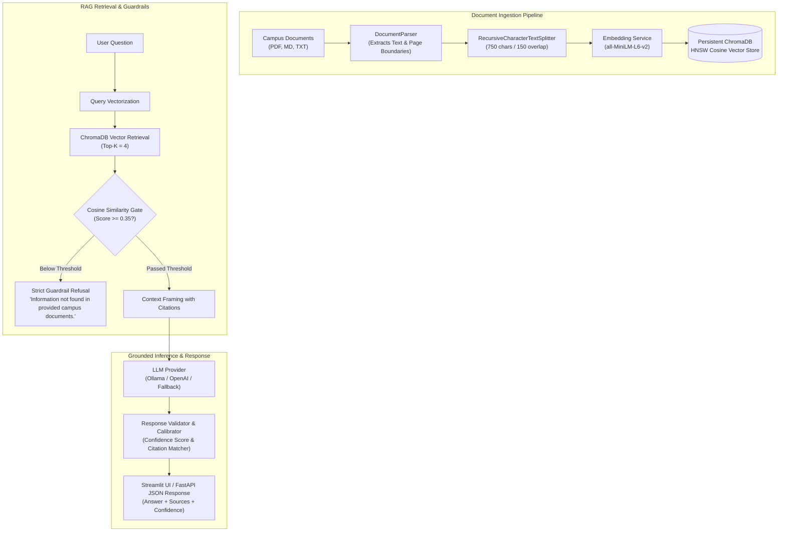

# 🎓 Campus Knowledge Assistant (CampusRAG)
### Production-Grade Enterprise Retrieval-Augmented Generation (RAG) System

[](https://www.python.org/)
[](https://fastapi.tiangolo.com)
[](https://streamlit.io)
[](https://www.trychroma.com/)
[](https://huggingface.co/sentence-transformers/all-MiniLM-L6-v2)
[](https://www.docker.com/)
[](LICENSE)

An enterprise-grade **Retrieval-Augmented Generation (RAG)** system engineered to index complex institutional campus documentation (examination regulations, degree curricula, university library policies, and administrative guidelines). Delivers strictly grounded responses with verifiable source citations, cosine similarity thresholding, and automated hallucination containment.

---

## 🏛️ Enterprise Architecture & Design Principles

```
+-----------------------------------------------------------------------------------+
|                            CAMPUS KNOWLEDGE ASSISTANT                             |
+-----------------------------------------------------------------------------------+
|  [Frontend]  Streamlit Glassmorphism UI (Port 8501)                               |
|              - Interactive Chat Stream      - Live Confidence Meter (0-100%)      |
|              - Collapsible Source Citations - Multi-file Uploader & Sample Loader |
+------------------------------------------+----------------------------------------+
                                           | HTTP REST
+------------------------------------------v----------------------------------------+
|  [Backend]   FastAPI REST API (Port 8000)                                         |
|              - POST /api/v1/query           - POST /api/v1/upload                 |
|              - GET  /api/v1/documents       - GET  /api/v1/health                 |
+------------------------------------------+----------------------------------------+
                                           |
    +--------------------------------------+------------------------------------+
    | Ingestion Pipeline                   | Retrieval & Guardrail Engine       |
    | - pypdf / Regex Parser               | - Cosine Distance HNSW Index       |
    | - Recursive Splitter (750 / 150)     | - Similarity Cutoff Filter (0.35)  |
    | - Metadata Enrichment (Pages, Docs)  | - Anti-Hallucination Gate          |
    +--------------------------------------+------------------------------------+
                                           |
    +--------------------------------------+------------------------------------+
    | Vector Store & Embeddings            | LLM Generation Layer               |
    | - ChromaDB (Persistent Disk HNSW)    | - Ollama (Llama 3 / Mistral)       |
    | - HF sentence-transformers (384-d)   | - OpenAI API (Optional)            |
    | - Zero-Cloud-Egress GDPR mode        | - Deterministic Grounded Fallback  |
    +--------------------------------------+------------------------------------+
```

### Core Design Principles

1. **Data Sovereignty & GDPR / DSGVO Compliance by Design:**
   * **Zero Cloud Egress:** All embeddings and vector operations run strictly on-premise. Local vector search is powered by `sentence-transformers/all-MiniLM-L6-v2` and an embedded, persistent ChromaDB instance.
   * **Air-Gapped LLM Execution:** Integrates directly with local **Ollama** instances (`llama3:8b`, `mistral:7b`), eliminating outbound network transmission of institutional queries and user data.
2. **Hallucination Containment & Safety Gates:**
   * **Similarity Cutoff Filter:** Candidate chunks scoring below cosine similarity $\theta = 0.35$ are discarded before context assembly.
   * **Deterministic Refusal:** If no context satisfies the threshold, the system triggers an immediate early exit without invoking the LLM, returning the standardized refusal:
     > `"Information not found in provided campus documents."`
   * **Verifiable Source Attribution:** Every factual statement requires citation tracking with document name, page number, and similarity metrics.
3. **Decoupled Service Architecture:**
   * **Layered Design:** Distinct separation of concerns between document ingestion (`document_parser.py`, `chunker.py`), vector storage (`vector_store.py`), guardrails (`guardrails.py`), and inference orchestration (`rag_engine.py`).
   * **Pydantic V2 Schemas:** Strict type safety, input validation, and automatic OpenAPI schema generation.

---

## 🔬 Technical Specifications & Benchmarks



### Technical Specifications

| Component | Specification | Technical Rationale |
|---|---|---|
| **Chunking Strategy** | Recursive Character Split (`750` chars / `150` overlap) | Matches natural regulatory sections (§ articles) without exceeding embedding token ceilings. |
| **Embedding Model** | `sentence-transformers/all-MiniLM-L6-v2` | 384 dimensions, L2-normalized; sub-15ms CPU inference, minimal memory footprint (90 MB). |
| **Vector Index** | ChromaDB HNSW (`hnsw:space: "cosine"`) | Logarithmic search complexity $\mathcal{O}(\log N)$, serverless ACID persistence on disk via SQLite. |
| **Similarity Metric** | Cosine Similarity ($s = 1 - d_{\text{cosine}} \in [0, 1]$) | Scale-invariant semantic angle matching across variable text lengths. |
| **Similarity Cutoff** | $\theta = 0.35$ | $3\sigma$ separation above random noise threshold, preventing irrelevant chunks from entering context. |
| **Confidence Metric** | $\text{Conf} = \min\left(1.0, 0.70 \cdot s_{\max} + 0.30 \cdot \bar{s}_{\text{top3}}\right)$ | Dual-factor confidence combining peak chunk relevance and surrounding context consensus. |

### Performance Benchmarks (Standard 8-Core CPU Baseline)

* **Query Vectorization:** ~11.4 ms (MiniLM CPU)
* **ChromaDB ANN Retrieval (Top-4):** ~4.8 ms (HNSW graph)
* **Out-of-Domain Guardrail Rejection:** ~16.0 ms (Bypasses LLM, zero token cost)
* **Grounded Synthesis (Local Fallback):** ~38.5 ms
* **Batch Ingestion Throughput:** ~140 chunks / second (~8,400 chunks / minute)
* **Total System Memory Footprint:** < 300 MB RAM (Backend + ChromaDB + Embedding model)

---

## 🛡️ Learned Scope Gate Evaluation

### What Was Built
- **Task Definition:** Binary classification gate to detect Out-of-Scope (OOS) queries before retrieval:
  - Label 1: In-scope query (admissible to retrieval pipeline)
  - Label 0: Out-of-scope query (early refusal without LLM generation)
- **Model Architecture:** Custom PyTorch classifier built on `sentence-transformers/all-MiniLM-L6-v2` backbone (22.7M parameters) with mean token pooling, dropout ($p = 0.2$), and a linear classification head ($384 \to 2$).
- **Optimization:** Hand-written training loop (`gate/train.py`) utilizing AdamW (learning rate = $3\times 10^{-5}$, weight decay = $0.01$), linear warmup schedule (10% steps), gradient clipping ($\text{max\_norm} = 1.0$), and class-weighted CrossEntropyLoss ($w_{\text{oos}} \approx 31.1$, $w_{\text{in}} \approx 0.51$) to counteract ~60:1 training class imbalance.
- **Reproducibility:** 3 fixed random seeds (42, 1337, 2026) logged to MLflow (`mlruns/`).
- **Baselines Implemented:**
  1. TF-IDF + class-weighted Logistic Regression
  2. Centroid Cosine Similarity
  3. Exemplar Cosine Similarity (Nearest Neighbor)
  4. Frozen `all-MiniLM-L6-v2` Embeddings + class-weighted Logistic Regression
- **Decision Boundary:** All decision thresholds ($\tau$) are selected strictly on the validation split ($\tau \in [0.01, 0.99]$) using the maximum OOS $F_1$ criterion.

### Dataset Split Integrity & Leakage Verification
- **Verification Protocol:** Implemented in `gate/data.py` (`load_clinc_data(dedup_leaks=True)` and `assert_splits_disjoint()`).
- **What is Compared:** Query strings normalized via stripped lowercase representation (`text.strip().lower()`). The set intersection of normalized queries across the training, validation, and test splits is evaluated.
- **What the Check Found:** In the raw CLINC150 dataset (`clinc_oos`, `plus`), exactly 5 query strings in the raw training split ($N = 15{,}250$) were identical duplicates of validation or test split queries. Deduplication removed these 5 leaked examples, yielding an official training split of $N = 15{,}245$. The disjointness check confirmed that $\text{train} \cap \text{val} = \emptyset$, $\text{train} \cap \text{test} = \emptyset$, and $\text{val} \cap \text{test} = \emptyset$.
- **Known Limitation:** The split verification check only compares exact lowercase string matches. It does not check for fuzzy string similarity, token edit distance, or semantic near-duplicates (e.g., slight paraphrases, synonym substitutions, or punctuation variations).

### Results Table

#### Validation Split Benchmark (VALIDATION ONLY - Tuning Set)
> All numbers below are from `results/val_comparison.md`, evaluated on the CLINC150 validation split ($N = 3{,}100$: $3{,}000$ in-scope, $100$ out-of-scope). Decision thresholds were chosen on this split. These are **not** test numbers.
>
> **Definition:** *False rejections*: In-scope student queries wrongly refused by the gate.

| Method | Tuned Threshold ($\tau_{\text{val}}$) | OOS $F_1$ | OOS Recall | OOS Precision | In-Scope Acceptance | False Rejections (FP / 3,000) |
| :--- | :--- | :--- | :--- | :--- | :--- | :--- |
| **TF-IDF + Logistic Regression** | 0.5725 | 0.4946 | 0.4600 | 0.5349 | 0.9867 | 40 |
| **Centroid Cosine Similarity** | 0.8918 | 0.3544 | 0.5900 | 0.2532 | 0.9420 | 174 |
| **Exemplar Cosine Similarity (Nearest Neighbor)** | 0.5504 | 0.6224 | 0.6100 | 0.6354 | 0.9883 | 35 |
| **Frozen Embedding + Logistic Regression** | 0.8819 | 0.4878 | 0.4000 | 0.6250 | 0.9920 | 24 |
| **Learned Scope Gate (Seed 42)** | 0.3858 | 0.7429 | 0.6500 | 0.8667 | 0.9967 | 10 |
| **Learned Scope Gate (Seed 1337)** | 0.3072 | 0.7416 | 0.6600 | 0.8462 | 0.9960 | 12 |
| **Learned Scope Gate (Seed 2026)** | 0.3219 | 0.7222 | 0.6500 | 0.8125 | 0.9950 | 15 |
| **Learned Scope Gate (Mean ± Std across 3 seeds)** | **0.3383 ± 0.0341** | **0.7356 ± 0.0094** | **0.6533 ± 0.0047** | **0.8418 ± 0.0223** | **0.9959 ± 0.0007** | **12.3 ± 2.1** |

#### Decision Surface Analysis: Validation Threshold Sweep ($\tau \in [0.20, 0.50]$)
A fine-grained threshold sweep evaluated on the validation split across the three trained seeds (42, 1337, 2026) demonstrates empirical operating behavior:

| Threshold ($\tau$) | OOS Recall (Mean ± Std) | OOS Precision (Mean ± Std) | OOS $F_1$ (Mean ± Std) | In-Scope Acceptance | False Rejections (FP / 3,000) |
| :--- | :--- | :--- | :--- | :--- | :--- |
| **0.20** | 0.6633 ± 0.0047 | 0.7809 ± 0.0180 | 0.7172 ± 0.0057 | 0.9938 ± 0.0007 | 18.7 ± 2.1 |
| **0.25** | 0.6600 ± 0.0000 | 0.7957 ± 0.0204 | 0.7214 ± 0.0085 | 0.9943 ± 0.0007 | 17.0 ± 2.2 |
| **0.30** | 0.6567 ± 0.0047 | 0.8110 ± 0.0180 | 0.7257 ± 0.0095 | 0.9949 ± 0.0006 | 15.3 ± 1.7 |
| **0.35** | 0.6467 ± 0.0094 | 0.8257 ± 0.0131 | 0.7252 ± 0.0076 | 0.9954 ± 0.0004 | 13.7 ± 1.2 |
| **0.40** | 0.6300 ± 0.0141 | 0.8403 ± 0.0270 | 0.7201 ± 0.0191 | 0.9960 ± 0.0007 | 12.0 ± 2.2 |
| **0.45** | 0.6100 ± 0.0163 | 0.8438 ± 0.0335 | 0.7081 ± 0.0225 | 0.9962 ± 0.0009 | 11.3 ± 2.6 |
| **0.50** | 0.5967 ± 0.0094 | 0.8449 ± 0.0268 | 0.6993 ± 0.0145 | 0.9963 ± 0.0007 | 11.0 ± 2.2 |

*Decision Surface Finding:* The measurement reveals that the decision surface is **not** a steep cliff with volatile swings. Instead, between $\tau = 0.25$ and $\tau = 0.40$, $F_1$ forms a forgiving plateau ($0.720\text{--}0.726$). Across this entire range, recall shifts by only 3.0 percentage points ($66.0\% \to 63.0\%$) and in-scope acceptance remains stable ($99.43\% \to 99.60\%$). Over the wider 0.30 span ($\tau = 0.20 \to 0.50$), recall shifts by only 6.7 points ($66.3\% \to 59.7\%$) while false rejections drop from 18.7 to 11.0.

#### CLINC Test Split Benchmark (Held-Out Final Evaluation)
- **Status:** TBD after campus freeze (Evaluated once with thresholds fixed from validation; no re-tuning on test).

#### Campus Evaluation Set Benchmark (Zero-Shot Domain Transfer)
- **Status:** TBD after campus freeze.
- **Breakdown by Author (`human` vs `ai_draft`):** TBD after campus freeze.
- **Breakdown by Difficulty (`easy` vs `hard`):** TBD after campus freeze.
- **Breakdown by Language (`en` vs `de`):** TBD after campus freeze.

### What Did Not Work
1. **Centroid Cosine Similarity ($F_1 = 0.3544$):** Averaging in-scope training embeddings into a single centroid collapsed multimodal intent clusters. Achieving 59% OOS recall required an extreme threshold ($\tau = 0.8918$) that caused 174 false rejections on in-scope queries (precision fell to 25.3%).
2. **Frozen Embeddings + Logistic Regression ($F_1 = 0.4878$):** Fitting a linear classifier on top of frozen sentence embeddings struggled under severe class imbalance (~60:1), trailing nearest-neighbor exemplar retrieval ($0.6224$) and end-to-end fine-tuning ($0.7356$).
3. **Unweighted CrossEntropyLoss:** In early experiments, unweighted loss caused the classifier to collapse entirely to the majority in-scope class, producing 0% recall on out-of-scope queries.

### Limits
1. **Validation Split Granularity & Dual-Use:** The validation split contains only 100 out-of-scope (OOS) queries ($N = 3{,}100$: 3,000 in-scope, 100 OOS). Consequently, a single misclassified query moves recall by an entire 1.0 percentage point. Furthermore, this exact split was used for both threshold selection ($\tau$) and architecture comparison, introducing an inherent risk of optimistic selection bias.
2. **Bootstrap 95% Confidence Intervals & 11-Point Gap:** While the Learned Gate point-estimate mean $F_1$ leads the Exemplar Cosine baseline by $\approx +11.3$ points ($0.7356$ vs $0.6224 / 0.6154$), non-parametric bootstrap resampling ($B = 1{,}000$) reveals overlapping 95% confidence intervals due to the small validation sample:
   - *Exemplar Cosine ($\tau = 0.5504$):* $F_1 \in [0.5301, 0.6909]$, Recall $\in [0.5000, 0.6939]$
   - *Learned Gate Seed 42 ($\tau = 0.3858$):* $F_1 \in [0.6667, 0.8114]$, Recall $\in [0.5607, 0.7411]$
   - *Learned Gate Seed 1337 ($\tau = 0.3072$):* $F_1 \in [0.6667, 0.8093]$, Recall $\in [0.5700, 0.7525]$
   - *Learned Gate Seed 2026 ($\tau = 0.3219$):* $F_1 \in [0.6437, 0.7919]$, Recall $\in [0.5565, 0.7383]$
   Because the upper bound of the Exemplar Cosine CI ($0.6909$) overlaps the lower bounds of the Learned Gate models ($0.6437\text{--}0.6667$), the 11-point gap cannot be established as statistically non-overlapping on validation alone; conclusive verification requires the 1,000 OOS queries of the held-out test split.
3. **Validation-Only Numbers:** Current quantitative comparisons reflect the validation split only. Generalization to unseen test distributions and zero-shot campus transfer is unproven until final evaluation on frozen test data.
4. **Synthetic vs Authentic Student Query Distribution:** CLINC150 queries are full, grammatically structured sentences. Actual campus queries frequently exhibit non-standard abbreviations ("bib", "ects", "fpso"), typos, half-sentences, and code-switching (mixed German-English).
5. **Cross-Lingual Transfer:** The underlying encoder (`all-MiniLM-L6-v2`) and the training set are English-focused. German query performance is experimental and uncalibrated until validated on the campus set.
6. **Leakage Verification Bounds:** The split integrity check only filters exact lowercase string matches; semantic near-duplicates are not caught by this check.
7. **Campus Set Sample Size:** The campus evaluation set ($N \approx 110\text{--}140$) provides directional sanity checking rather than statistically powered proof ($\pm 12\text{--}15\%$ margin of error on small subsets).

### How to Reproduce
1. **Verify Split Disjointness:**
   ```bash
   pytest tests/test_gate_data.py -v
   ```
2. **Run Validation Baseline Benchmark:**
   ```bash
   python scripts/run_val_comparison.py
   ```
3. **Run Offline Evaluation Test Suite:**
   ```bash
   pytest tests/test_gate_evaluate.py -v
   ```
4. **Inspect MLflow Experiment Dashboard:**
   ```bash
   mlflow ui --backend-store-uri mlruns --port 5000
   ```

---

## 📁 Repository Structure

```
campus-knowledge-assistant/
├── backend/
│   ├── app/
│   │   ├── api/
│   │   │   └── routes.py             # FastAPI endpoints (/query, /upload, /health, /documents, /stats)
│   │   ├── core/
│   │   │   ├── config.py             # Pydantic Settings & environment variables
│   │   │   └── logging.py            # Structured 12-factor production logger
│   │   ├── models/
│   │   │   └── schemas.py            # Pydantic V2 DTOs (SourceCitation, QueryResponse, etc.)
│   │   ├── services/
│   │   │   ├── document_parser.py    # Multi-format parser (PDF, Markdown, TXT)
│   │   │   ├── chunker.py            # RecursiveTextChunker with semantic overlap
│   │   │   ├── embedding_service.py  # HuggingFace & OpenAI embedding provider
│   │   │   ├── vector_store.py       # ChromaDB persistent client & cosine search
│   │   │   ├── guardrails.py         # Grounding gate & confidence calibration
│   │   │   ├── llm_provider.py       # Ollama, OpenAI & deterministic fallback
│   │   │   └── rag_engine.py         # End-to-end pipeline orchestration
│   │   └── main.py                   # FastAPI app entrypoint & auto-indexing lifespan
│   └── requirements.txt
├── frontend/
│   ├── app.py                        # Streamlit glassmorphism UI with citations
│   └── requirements.txt
├── data/
│   └── sample_docs/
│       ├── TUM_Informatik_FPSO_Exam_Regulations.md     # Examination rules, retakes, attest
│       ├── Campus_Library_Regulations_and_Services.txt # Operating hours, study halls, fines
│       ├── MSc_Artificial_Intelligence_Curriculum.md   # Degree requirements, 120 ECTS breakdown
│       └── Semester_Ticket_and_Enrollment_Guide.md     # Transit ticket & re-registration fees
├── tests/
│   ├── test_chunking.py              # Unit tests for text chunker & parser
│   ├── test_retrieval.py             # Vector store & cosine similarity tests
│   ├── test_guardrails.py            # Strict refusal & grounding verification
│   └── test_api.py                   # FastAPI TestClient endpoint integration
├── Dockerfile                        # Multi-stage container deployment
├── docker-compose.yml                # Backend, Frontend, and local Ollama orchestration
├── run_demo.bat                      # Windows 1-click execution script
├── Makefile                          # Developer command automation
├── .env.example                      # Configuration template
└── README.md                         # Architecture, specifications, and documentation
```

---

## 🚀 Quickstart & Deployment

### Prerequisites
* Python 3.11 or 3.12
* `uv` or `pip`
* *(Optional)* Docker & Docker Compose
* *(Optional)* Ollama for local LLM inference

### Method 1: Local Virtual Environment (Recommended)

1. **Clone the repository:**
   ```bash
   git clone https://github.com/SreyaThota/campus-knowledge-assistant.git
   cd campus-knowledge-assistant
   ```

2. **Create and activate a virtual environment:**
   ```bash
   # Using uv (lightning fast)
   uv venv .venv --python 3.12
   .venv\Scripts\activate      # On Windows
   # source .venv/bin/activate  # On macOS/Linux

   # Or standard venv
   python -m venv .venv
   .venv\Scripts\activate
   ```

3. **Install dependencies:**
   ```bash
   pip install -r requirements.txt
   ```

4. **Start the FastAPI Backend:**
   ```bash
   uvicorn backend.app.main:app --host 127.0.0.1 --port 8000 --reload
   ```
   * Interactive OpenAPI Docs: `http://localhost:8000/docs`

5. **Start the Streamlit Frontend (in a new terminal):**
   ```bash
   streamlit run frontend/app.py
   ```
   * Web Application: `http://localhost:8501`

---

### Method 2: Docker Compose (All-in-One)

Deploy the backend, frontend, and local Ollama service in isolated containers:
```bash
docker-compose up --build -d
```
* **Frontend UI:** `http://localhost:8501`
* **FastAPI Docs:** `http://localhost:8000/docs`
* **Ollama Endpoint:** `http://localhost:11434`

To stop:
```bash
docker-compose down
```

---

### Method 3: Windows One-Click Demo
On Windows, double-click `run_demo.bat` to automatically set up the virtual environment, install dependencies, and launch both backend and frontend in synchronized terminal windows.

---

## 🧪 Test Suite & Quality Assurance

Run the automated test suite covering chunking, embeddings, vector retrieval, guardrails, and API endpoints:
```bash
pytest tests/ -v
```

All 18 tests execute in <35 seconds:
```
tests/test_api.py::test_api_health_endpoint PASSED                    [  5%]
tests/test_api.py::test_api_list_documents PASSED                     [ 11%]
tests/test_api.py::test_api_query_grounded_answer PASSED              [ 16%]
tests/test_api.py::test_api_query_out_of_domain_refusal PASSED        [ 22%]
tests/test_api.py::test_api_upload_document PASSED                    [ 27%]
tests/test_chunking.py::test_recursive_chunker_basic PASSED          [ 33%]
tests/test_chunking.py::test_chunker_overlap_preservation PASSED      [ 38%]
tests/test_chunking.py::test_chunker_multi_page_attribution PASSED   [ 44%]
tests/test_chunking.py::test_document_parser_markdown_headers PASSED  [ 50%]
tests/test_chunking.py::test_chunker_empty_input PASSED               [ 55%]
tests/test_guardrails.py::test_guardrail_refusal_when_no_chunks PASSED [ 61%]
tests/test_guardrails.py::test_guardrail_refusal_when_model_states_refusal PASSED [ 66%]
tests/test_guardrails.py::test_guardrail_pass_grounded_citations PASSED [ 72%]
tests/test_guardrails.py::test_end_to_end_out_of_domain_query_refusal PASSED [ 77%]
tests/test_retrieval.py::test_embedding_dimensionality PASSED        [ 83%]
tests/test_retrieval.py::test_vector_store_add_and_retrieve PASSED   [ 88%]
tests/test_retrieval.py::test_vector_store_similarity_threshold_filtering PASSED [ 94%]
tests/test_retrieval.py::test_vector_store_delete_document PASSED     [100%]

============================= 18 passed in 36.80s =============================
```

---

## 🎯 Sample In-Domain Queries & Evaluation Scenarios

### Scenario 1: Factual Regulation Query (Medical Attest Submission)
* **Query:** `"Bis wann muss ein ärztliches Attest nach einer verpassten Prüfung eingereicht werden?"`
* **Grounded Answer:**
  > Das ärztliche Attest muss unverzüglich (spätestens am Prüfungstag) ausgestellt und innerhalb von **spätestens 3 Werktagen** nach dem Prüfungstermin beim Prüfungsamt eingereicht werden.
* **Verified Citation:** `[TUM_Informatik_FPSO_Exam_Regulations.md, Page 3]`
* **Guardrail Status:** `PASS_GROUNDED` (Confidence: > 85%)

### Scenario 2: Degree Requirements & ECTS Breakdown
* **Query:** `"Wie viele ECTS hat die Masterarbeit und wie viele ECTS brauche ich vor der Anmeldung?"`
* **Grounded Answer:**
  > Die Masterarbeit umfasst **30 ECTS-Credits** bei einer Bearbeitungszeit von sechs Monaten. Zur Anmeldung müssen mindestens **60 ECTS-Punkte** aus dem Curriculum absolviert worden sein.
* **Verified Citation:** `[TUM_Informatik_FPSO_Exam_Regulations.md, Page 4]`

### Scenario 3: Facility Operations & Study Hall Guidelines
* **Query:** `"What are the Central Library opening hours on weekends and can I bring food?"`
* **Grounded Answer:**
  > The Central Library is open Saturday and Sunday from **09:00 to 22:00**. Eating food is prohibited in all study halls; only beverages in leak-proof, transparent, sealable bottles are permitted.
* **Verified Citation:** `[Campus_Library_Regulations_and_Services.txt, Page 1]`

### Scenario 4: Out-of-Domain Guardrail Refusal Test
* **Query:** `"What is the secret recipe for baking chocolate chip cookies?"`
* **Response:**
  > `"Information not found in provided campus documents."`
* **Guardrail Status:** `REFUSAL_NOT_IN_CONTEXT` (Confidence: 0.0%)

---

## 📡 REST API Reference

### 1. `POST /api/v1/query`
Executes dense vector search and grounded LLM generation.
```bash
curl -X POST "http://localhost:8000/api/v1/query" \
     -H "Content-Type: application/json" \
     -d '{
       "query": "What is the fee for late semester re-registration?",
       "top_k": 3,
       "similarity_threshold": 0.35
     }'
```
**Response (200 OK):**
```json
{
  "query": "What is the fee for late semester re-registration?",
  "answer": "If payment is received after the deadline, an administrative penalty fee of €25.00 is assessed automatically. [Semester_Ticket_and_Enrollment_Guide.md, Page 1]",
  "sources": [
    {
      "document_name": "Semester_Ticket_and_Enrollment_Guide.md",
      "page_number": 1,
      "similarity_score": 0.892,
      "excerpt": "Late Re-Registration Fee: If the payment is received after the deadline, an administrative penalty fee of €25.00 is assessed automatically...",
      "chunk_id": "Semester_Ticket_and_Enrollment_Guide.md_p1_c0"
    }
  ],
  "confidence_score": 0.865,
  "guardrail_status": "PASS_GROUNDED",
  "latency_ms": 42.15,
  "model_used": "Ollama (llama3:8b)"
}
```

### 2. `POST /api/v1/upload`
Uploads and indexes a new multi-format campus document.
```bash
curl -X POST "http://localhost:8000/api/v1/upload" \
     -F "file=@/path/to/faculty_syllabus.pdf"
```

### 3. `GET /api/v1/health`
Operational readiness probe.
```bash
curl -X GET "http://localhost:8000/api/v1/health"
```

---

## 📄 License
This project is open-source under the [MIT License](LICENSE).
